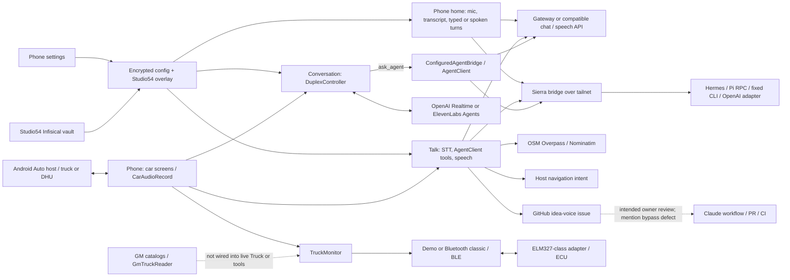

# Architecture as implemented

## As is

Updated **2026-11-09** for phone conversations, following the reviewed baseline `210448b`.
Diagram arrows mean implemented integration, not successful truck acceptance.
[STATUS.md](STATUS.md) records defects and evidence limits.

## Ownership and boundaries

| Package / area | Responsibility |
| --- | --- |
| `phone/` | Launcher conversation UI, screen-local rolling context and stable bridge ID, typed and continuous voice turns; lifecycle cancellation, phone mic and shared VoiceStack. Settings remain in MainActivity. No car Places/OBD/local tool UI on the phone home |
| `car/` | `SierraCarAppService`/session, Home/Places/Talk/Conversation/History/Truck/Codes/Mic test; host templates, content limits and lifecycle |
| `agent/` | Effective gateway/bridge route (`AgentConfig`), encrypted settings, rolling six-turn chat context, 20-entry history; nonstreaming OpenAI-compatible tool loop (up to four model rounds) |
| `agent/tools/`, `places/` | `find_places`, `navigate_to`, `file_idea`; location and OSM lookup. No vehicle-reading or profile-switch tools |
| `voice/stt/`, `tts/`, `convo/` | PCM capture/detection/transcription, sentence-based speech fetch/playback, turn state machine. Talk wires these when a transcription/capture path is available; system recognizer is the fallback |
| `voice/duplex/` | Separate realtime Conversation: OpenAI/ElevenLabs sessions, resampling, jitter/echo guard, interruption, `ask_agent` and adapted Talk tools |
| `voice/realtime/` | Older experimental implementation; saved settings remain but Talk does not wire this loop |
| `voice/diagnostics/` | Input selection, explicit phone microphone foreground service and bounded redacted diagnostic events; Android controls final physical routing |
| `studio54/` | Universal-auth vault, memory access token, encrypted cache (up to three days), independent complete URL/key overlays and an in-memory ElevenLabs voice-key overlay; chat selector does not redirect speech credentials |
| `obd/`, `obd/bt/`, `obd/live/` | Synchronized allowlisted ELM client, classic/BLE, demo, supported standard PID polling and stored codes; connection is tied to Truck screen, not a persistent vehicle service |
| `obd/gm/` | Unverified enhanced DID catalogs/decoders/readers, not live UI/voice integration |
| `update/`, workflows | Install-record heuristic, non-Play signer-checked GitHub updater and experimental Shizuku path; `PLAY_BUILD` hides self-update UI and Play manifest removes installer permissions. Manual Play-internal workflow is separate from APK release CI |
| `bridge/sierra_bridge/` | Standard-library threaded HTTP server, bearer check, model-to-adapter mapping, plain/SSE replies, speech cleanup and full-reply JSONL logging; Linux service/tailnet deployment |

## Data, credentials and failure boundaries

The phone's selector changes chat only. Main/gateway speech and separate duplex service settings are independent. A complete vault pair replaces its typed pair; model/profile choices remain local. For the standard VoiceStack, a nonblank vault `ELEVENLABS_API_KEY` replaces the typed fallback in memory; provider, voice ID and model stay local, and the resolved key is never saved to voice settings or displayed. Voice output caches compare resolved settings so a changed key rebuilds them on the next lookup. Cache expiry can reveal typed fallback, and signing out does not revoke remote keys. Several encrypted stores still delete data on any open failure: encryption is implemented, nondestructive recovery is not.

Audio is sent to configured transcription/realtime services; chat/history and backend logs can contain personal content. Diagnostic reports intentionally exclude audio/transcripts/keys/endpoint addresses, but that is not the privacy policy of all stores or provider logs. OSM data and model-produced idea content are untrusted. `idea-voice` is an intended human gate, currently bypassable by an `@claude` issue mention.

The bridge has one shared bearer boundary, not robust per-client isolation. Reply-text conversation matching can still collide for older clients. November 9 phone and car Talk changes supply stable IDs; the legacy server fallback remains. Auth-body framing, off-origin credential redirects, streaming cleanup, CLI shutdown and incremental number formatting have confirmed review findings. The bridge forwards text and selected generation parameters, not a complete OpenAI tool proxy contract. Restrict service account, cwd, secrets and network exposure; tailnet transport does not fix those defects.

OBD reads never supply agent truth today. Demo values are synthetic, NO DATA can be misleading in Codes, and real reconnect/key-off and GM accuracy are unverified. The low-level client has an explicit guarded Mode 04 API, but no clear action is exposed in the car UI; do not describe the entire package as physically incapable of writes.

## Build and workspace

Android: Kotlin/JDK 17, compile/target SDK 36, min SDK 29, Car App Library/projected 1.7.0; Robolectric/FakeHost and mock servers exercise software, not release-host trust or real acoustics. Python bridge requires 3.11+, uv and project-local `.venv`.

Canonical checkout is `/home/mdc/Projects/sierra-auto` on the Linux development machine. Local evidence (separate from application baseline) uses `.local/{reviews,runs,state,archive,downloads}`. Script paths resolve through Git common-dir to the canonical root even from linked trees. Runs default to `.local/runs`, DHU state to `.local/state/dhu`, downloads to `.local/downloads/releases`; `SIERRA_RUNS`/`SIERRA_STATE` overrides must remain under canonical `.local`. The JDK/SDK toolchain is user-scoped (`source .local/omarchy-toolchain/env.sh`); credential locations remain external. See [TESTING.md](TESTING.md) and [WORKSPACE.md](WORKSPACE.md) for operational details.

## Next steps

Repair P1 boundaries before increasing backend/automation trust; add stable profile/model-scoped conversation IDs and nondestructive store recovery. Bound voice/network/native teardown and preserve unknown/stale vehicle/location results. Only after standard physical adapter and parked voice acceptance should the separate GM readers, vehicle tools or named-profile proposals become live integrations; each needs explicit lifecycle, privacy and evidence contracts.
