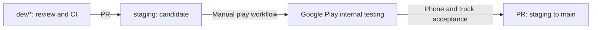

# Development, staging and deployment

## As is — 2026-11-17

Sierra uses short-lived `dev/*` branches, a shared `staging` branch and `main` as the accepted source baseline. Work stays in the canonical checkout; extra worktrees are optional and must use the workspace helper.

- Pushes to `dev/*`, `staging` and `main` run applicable validation. PRs run validation as well.
- The build workflow checks that a PR targeting `main` comes from this repository's `staging` branch. This CI check is not itself server-side branch protection.
- The `play` workflow can deploy only from `staging`. It runs Android unit tests/lint (including Play release lint), bridge tests and secret scanning before the signing/upload job. Missing secrets fail the job instead of reporting a successful skipped upload.
- Play deployment is manually dispatched to the **internal testing** track. It does not publish to production.
- Pushes and merges do not publish GitHub APK releases under this workflow. An optional GitHub APK requires manually running `build` on `main` with `publish_github=true`; validation must pass first.
- These rules take effect for a branch when it contains the workflow changes. The old workflow on `main` remains active until this workflow change is promoted there. In particular, do not dispatch the old Play workflow on main.

## Next steps for each change

1. Create a `dev/<topic>` branch from the current staging baseline. Keep source changes and tests together. Review all new files and run relevant local checks; never commit credentials or private captures.
2. Push the development branch and open a draft PR into `staging`. Review CI and resolve new failures. Promote only the completed change to staging; preserve unrelated experiments separately.
3. Freeze the staging candidate for the test cycle. Record its full SHA and run `play` with **branch staging**, an explicit unused `version_code`, and `status=completed` for internal availability (or `draft` for Console preparation). Select a code greater than every previously uploaded Play version and every installed version that must be updated. The last locally recorded ADB phone build was 100009; the workflow rejects codes at or below that floor. This floor does not query the Play Console and does not prove a larger number is unused.
4. Verify the exact workflow SHA, successful upload step, version code, signer and tester availability. A green workflow is not evidence that the phone updated. Install/update through Play, retain the installation record, and execute the parked phone/truck acceptance checks. Do not replace the candidate with an ADB installation during provenance testing.
5. Open a PR from `staging` into `main`, linking the tested staging SHA, Play run/version and acceptance evidence. If staging changes after testing, validate and test the new candidate before promotion. Use a merge commit to preserve ancestry; check that the promoted source tree matches the tested candidate. Do not squash the long-lived staging-to-main promotion branch.
6. After promotion, reconcile staging with main and start the next development branch from the updated staging baseline. Optional GitHub APK publication is separate from Play and may use a lower version-code sequence; it is not the phone update route.

The current checkpoint is prepared on `dev/phone-voice-checkpoint`. Staging starts at the fetched GitHub main baseline; development reaches it through a reviewed PR. No Play upload or device installation is implied by creating or pushing these branches.

## Gates and limits

GitHub branch protection was enabled and verified for staging and main on 2026-11-17: PRs are required, branches must be up to date, and promotion, secret-scan, lint and build must pass. Enforcement includes administrators; force pushes and branch deletion are disabled. The required external approval count is zero so the owner can merge after reviewing the evidence. These settings do not substitute for phone/truck acceptance. Known application defects and physical acceptance gaps remain recorded in STATUS.md.

The old `install-record` experiment is not required for Google Play. Retain it and `pr27-phase1-merge` until a separate ancestry/patch-equivalence review determines which changes, if any, remain useful.
